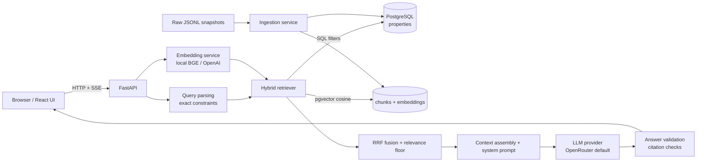

# DarGlobal & Wasalt — Real Estate Intelligence Assistant

A production-oriented, source-grounded RAG chatbot built over publicly available
DarGlobal and Wasalt real-estate information. It is **not** a generic chatbot:
answers come with source filters, property cards, structured comparisons,
clickable citations and explicit "unknown" behaviour.

> **Status:** fully implemented, containerized, security-tested and running
> locally (Docker Compose: frontend `:8080`, backend `:8000`, DB + pgvector).
> Public deployment (backend on Render, frontend on Vercel) is configured via
> `render.yaml` / `vercel.json` but must be executed from the assignment owner's
> own accounts (see `docs/DEPLOYMENT.md`).

---

## 1. Problem and approach

Recruiters need to evaluate a junior AI engineer's ability to ship an end-to-end
Applied AI product, not a notebook. The application therefore covers the entire
path: polite public data acquisition → normalization → hybrid retrieval → grounded
generation → API → UI → containers → deployment configuration → tests.

Two real constraints shaped the data layer:

1. **`darglobal.com` no longer hosts the developer site** — it redirects to an
   unrelated IT holding. The official domain `darglobal.co.uk` serves an Incapsula
   challenge to automated requests. Public Wayback Machine snapshots were used
   instead, with explicit `archived_snapshot` provenance.
2. **Wasalt detail pages return HTTP 403 to plain HTTP.** A small number of public
   pages were read through a browser renderer, and the public sitemaps were used
   for URL discovery. No CAPTCHA, authentication or anti-bot control was bypassed.

See `docs/DATA_COLLECTION_REPORT.md` and the two access-notes files for the full,
unvarnished record. **No synthetic or fabricated property data was added.**

---

## 2. Features

- Hybrid retrieval: exact SQL constraints (source, city, type, beds, baths, price)
  fused with pgvector semantic search via Reciprocal Rank Fusion.
- Relevance floor so unrelated questions return "I don't have that information"
  instead of confidently irrelevant listings.
- Conversation state persisted in PostgreSQL; follow-ups work across restarts.
- Streaming SSE responses with a final structured event carrying citations.
- Provider-agnostic LLM layer (OpenRouter by default; OpenAI / Gemini / Anthropic /
  OpenAI-compatible local endpoints via env vars).
- Local embedding model (BGE-small via fastembed) — ingestion works before any
  API key is supplied; no property text is sent to an embedding vendor.
- Source isolation (`darglobal` / `wasalt` / `both`) in both retrieval and UI.
- Filter options (cities, property types, bedroom counts, max price) are derived
  from the indexed corpus via `/api/v1/stats`, so they can't offer impossible values.
- If an exact combination still matches nothing, constraints relax progressively
  and the answer clearly labels the results as alternatives.
- Recent conversations are archived locally; "New conversation" never deletes them.
- Property cards, clickable citations, filter bar, clear-chat, loading and error
  states, accessible keyboard interactions, responsive layout.
- Admin ingestion protected by `X-Admin-Key`; rate limiting, CORS allowlist,
  security headers, input validation, no stack traces in responses.
- Idempotent ingestion: content hashes mean re-running ingestion does not
  duplicate or needlessly re-embed records.

---

## 3. Architecture



Detailed component and data-flow notes: `docs/ARCHITECTURE.md`.

### Request lifecycle

`User query → frontend → POST /api/v1/chat → parse exact constraints → embed →
SQL prefilter + pgvector search → RRF → context → LLM → validate answer/citations
→ persist conversation → answer + sources → frontend (property cards + citations)`.

---

## 4. Technology stack

| Layer | Choice | Why |
|---|---|---|
| Frontend | React 18, Vite 5, lucide-react, plain CSS | Small, fast, no design-system lock-in |
| Backend | FastAPI, Pydantic v2, SQLAlchemy 2 async | Strong validation, async concurrency, OpenAPI |
| Database | PostgreSQL 16/17 + pgvector | Structured filters + vector search in one transaction |
| Embeddings | `BAAI/bge-small-en-v1.5` via fastembed (384d) | Local, no key, low latency; OpenAI option available |
| LLM | OpenRouter (default `openai/gpt-4o-mini`) | One key, many swappable models, free options available |
| Scraping | httpx + BeautifulSoup, robots.txt, sitemaps | Simple, polite, no JS needed for the chosen pages |
| Containers | Multi-stage Dockerfiles, Compose, Render Blueprint | Reproducible local + cloud deployment |

---

## 5. Data acquisition

- `backend/app/scraper/` — polite, modular scrapers with robots.txt checks,
  delays, retries/backoff, timeouts, sitemap discovery, deduplication and
  JSONL snapshots. Blocks are recorded, never bypassed.
- `data/raw/*.jsonl` — the actual committed snapshots used for ingestion
  (29 DarGlobal + 28 Wasalt records). Each row keeps its source URL,
  provenance and scrape timestamp.
- Missing fields are `null`; descriptions with ranges (e.g. "1 to 3-bedroom
  residences") are preserved as text rather than coerced into misleading numbers.

Re-collect where access permits:

```bash
cd backend
../.venv/bin/python -m app.scraper.run --source both --limit 40
```

---

## 6. RAG implementation

1. **Normalize** JSONL into `properties` (content-hash deduplication).
2. **Chunk** the flattened attribute text with paragraph/sentence boundaries and
   light overlap; attach source, URL, location, type and scrape timestamp.
3. **Embed** each chunk once (idempotent re-indexing).
4. **Retrieve**: parse exact constraints from the question and the UI filters;
   SQL `WHERE` on properties supplies candidate IDs to both channels; pgvector
   cosine distance supplies semantic candidates; RRF merges them.
5. **Relevance floor**: semantic similarity below `MIN_SEMANTIC_SIMILARITY`
   (default 0.65, calibrated on this corpus) yields no evidence.
6. **Generate** with a strict system prompt that treats retrieved text as data,
   forbids invention, requires source attribution and admits gaps.
7. **Validate**: citation markers outside the retrieved set are removed; if there
   are no citations, the answer is a fixed "insufficient evidence" message and
   the LLM is not called at all.

---

## 7. LLM provider configuration

Everything is environment-driven; no key is in source or in the frontend.

```bash
LLM_PROVIDER=openrouter
LLM_BASE_URL=https://openrouter.ai/api/v1
LLM_MODEL=openai/gpt-4o-mini
LLM_API_KEY=sk-or-v1-...
```

**Automatic fallback:** if the primary provider fails (rate limit, exhausted
credits, timeout, 5xx), the same grounded prompt is retried on a second
OpenAI-compatible provider — Groq by default:

```bash
LLM_FALLBACK_PROVIDER=groq
LLM_FALLBACK_BASE_URL=https://api.groq.com/openai/v1
LLM_FALLBACK_MODEL=openai/gpt-oss-120b
GROQ_API_KEY=...
```

`LLM_FALLBACK_API_KEY` can be used instead of `GROQ_API_KEY` for a generic
second provider. The fallback never switches mid-stream: if tokens were already
sent, the error is surfaced rather than mixing two models in one answer.

Switch to another provider by changing `LLM_BASE_URL` / `LLM_MODEL` /
`LLM_API_KEY`. OpenAI-native: `https://api.openai.com/v1` + `gpt-4o-mini`.
Gemini OpenAI-compat: `https://generativelanguage.googleapis.com/v1beta/openai/`
+ `gemini-2.0-flash`. Anthropic OpenAI-compat or a local model server also work.
Embeddings can be switched with `EMBEDDING_PROVIDER=openai` (then set
`EMBEDDING_DIM=1536` and recreate the index).

Before a key is supplied the app still starts; retrieval, search, stats and
property browsing work, and chat returns a clear configuration warning plus
valid source citations.

---

## 7b. Access control

- `POST /api/v1/admin/ingest` requires `X-Admin-Key` — only you can ingest/re-index.
- The public chat/search/properties APIs are open by default so a recruiter can
  use the URL immediately. Set `APP_ACCESS_CODE` to require a shared code via
  `X-Access-Code`; the UI then shows a small gate before the chat. `/health`,
  `/docs` and `/api/v1/access` stay public so the platform can health-check.
- The code is kept in browser memory only (never persisted to localStorage).
- An honest `llms.txt` in `frontend/public/` describes the project for AI crawlers.

## 8. Database schema

- `properties` — normalized listing/development with nullable attributes,
  `source_url`, `scraped_at`, `content_hash` (unique), JSONB amenities/images/metadata.
- `chunks` — `property_id` FK, text, `vector(384)` embedding, provenance metadata,
  unique `(property_id, chunk_index)`.
- `ingestion_runs` — start/end, status, pages/records/chunks counters, notes.
- `conversations` — server-side message history (bounded by
  `MAX_CONVERSATION_TURNS`).

Indexes: source/city/type/price/bedrooms on properties; HNSW (fallback IVFFLAT)
on chunk embeddings. Schema creation is idempotent at startup.

---

## 9. Local setup

```bash
cp .env.example .env          # then edit values
python3 -m venv .venv
.venv/bin/pip install -r backend/requirements.txt
cd frontend && npm install && npm run build && cd ..

# Postgres with pgvector, then:
cd backend
../.venv/bin/uvicorn app.main:app --host 0.0.0.0 --port 8000
```

Frontend dev server: `cd frontend && npm run dev` (http://localhost:5173).

Admin ingestion:

```bash
curl -X POST http://localhost:8000/api/v1/admin/ingest \
  -H "X-Admin-Key: $ADMIN_API_KEY" -H 'Content-Type: application/json' \
  -d '{"source":"both"}'
```

Or use `scripts/ingest.sh`.

---

## 10. Docker

```bash
./scripts/bootstrap_local.sh
docker compose up --build
```

- Frontend: http://localhost:8080
- Backend: http://localhost:8000
- API docs: http://localhost:8000/docs
- Postgres data persists in the named volume `postgres_data`.

All images were built and the stack was verified locally with `docker compose up
--build`; ingestion produced 57 records and the frontend served the chat UI.
Use `./scripts/docker` if the Docker CLI is not on `PATH`. See `docs/DEPLOYMENT.md`.

---

## 11. Deployment

`render.yaml` is a **backend-only** Blueprint (FastAPI web service). The database
is an external pgvector-capable **Neon** Postgres — see `docs/NEON_SETUP.md` for
the exact setup — and the frontend is deployed on **Vercel** via `vercel.json`.
The assignment owner deploys from their own accounts because no credentials were
shared. Steps, env vars, ingestion and external verification are in
`docs/DEPLOYMENT.md`.

> **Public URL:** pending the user-side Render deployment. Do not treat the app as
> deployed until the smoke tests in `docs/DEPLOYMENT.md` pass from an external network.

---

## 12. API documentation

Interactive docs: `/docs` and `/redoc`. Endpoints:

| Method | Path | Purpose |
|---|---|---|
| GET | `/health` | Liveness + DB/chunk counters |
| GET | `/api/v1/sources` | Per-source record/chunk counts |
| GET | `/api/v1/stats` | Corpus statistics and last ingestion |
| POST | `/api/v1/chat` | Answer + citations (or SSE when `stream:true`) |
| GET | `/api/v1/properties` | Structured browsing/filtering |
| GET | `/api/v1/properties/{id}` | Single record |
| POST | `/api/v1/search` | Hybrid search without generation |
| POST | `/api/v1/admin/ingest` | Protected re-ingestion |

Full payloads: `docs/API_CONTRACT.md`.

---

## 13. Tests and quality

```bash
cd backend && ../.venv/bin/python -m pytest -q
RUN_DB_TESTS=1 ../.venv/bin/python -m pytest -q   # needs ingested Postgres
```

37 tests cover text/chunking, query filters (including hyphenated "3-bedroom"),
scraper extraction, ingestion normalisation/dedup, grounding/citation validation,
API validation/auth/headers,
and live hybrid retrieval with source/filter isolation. Results:
`docs/TEST_RESULTS.md`.

---

## 14. Known limitations

- DarGlobal data is archived, not live, and contains no prices. The UI states the
  data reflects the last successful scrape.
- Wasalt is a 28-listing snapshot; daily-rental prices were not rendered, so they
  are `null`.
- Rate limiting is per-process in memory; a multi-instance deployment needs a
  shared store (documented in `docs/DEPLOYMENT.md`). Proxy headers are deliberately
  not trusted to avoid `X-Forwarded-For` spoofing.
- Render free-tier Postgres may not support pgvector; use an external pgvector
  database (e.g. Neon) via `DATABASE_URL` if needed.
- Final answer quality was verified with a real OpenRouter key; the configured
  default is `openai/gpt-4o-mini`, which is not necessarily free — change
  `LLM_MODEL` to a free OpenRouter model if you want zero generation cost.

## 15. Future improvements

- Cross-encoder reranking after RRF; query-cache for repeated filters.
- Admin UI for ingestion status and snapshot review.
- Scheduled re-ingestion with diff alerts; screenshot capture after deployment.
- Shared Redis rate limiter for horizontal scaling.
