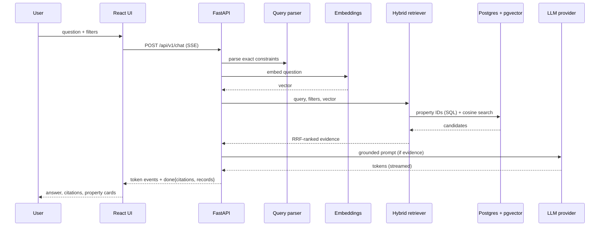

# Architecture & Implementation Notes

## Components

| Component | Location | Responsibility |
|---|---|---|
| Browser UI | `frontend/src/` | Chat, filters, citations, property cards, SSE parsing |
| API | `backend/app/main.py`, `app/routers/` | Validation, auth, rate limits, CORS, routing |
| Query parser | `app/services/query.py` | Deterministic extraction of beds/baths/city/type/price/intent |
| Embeddings | `app/services/embeddings.py` | Local fastembed BGE or OpenAI-compatible embeddings |
| Hybrid retriever | `app/services/retrieval.py` | SQL prefilter + pgvector + RRF + relevance floor |
| RAG service | `app/services/rag.py` | Context assembly, generation, validation, conversation memory |
| LLM client | `app/services/llm.py` | Swappable OpenAI-compatible provider, concurrency semaphore |
| Ingestion | `app/services/ingestion.py` | Normalize → hash → upsert → chunk → embed → index |
| Scrapers | `app/scraper/` | Polite public-data acquisition into JSONL |
| Storage | `app/models.py` | properties, chunks, ingestion_runs, conversations |

## Why hybrid retrieval

Real-estate questions mix exact constraints ("3 bedrooms", "Riyadh", "under 2M
SAR") with contextual language ("family-friendly", "near the coast"). Pure vector
search silently drops exact constraints; pure SQL cannot answer contextual
questions. The retriever:

1. Parses exact constraints from both the request `filters` object and the natural
   language question (explicit UI values win).
2. Builds a parameterised SQL subquery over `properties` and uses the same
   candidate ID set for **both** the structured channel and the pgvector channel.
   This was a real bug found during testing: without the shared subquery, price
   and bedroom constraints were ignored by the vector channel.
3. Ranks each channel and fuses with RRF (`score = Σ 1/(k+rank)`). The structured
   channel only contributes when an actual exact filter exists, otherwise it
   would inject arbitrary recent records into every answer.
4. Applies a similarity floor (calibrated at ~0.65 for BGE-small on this corpus:
   on-topic ≈0.77, off-topic ≈0.51) so unrelated questions produce no evidence.

## Grounding and safety

- The system prompt treats all retrieved excerpts as untrusted data.
- Citations are built from retrieved records, never from model output.
- Answer validation strips `[n]` markers outside the retrieved range.
- Zero retrieved records → fixed "insufficient evidence" answer; the LLM is not
  called, which makes hallucination impossible for that path.
- LLM output is rendered as React text (no `dangerouslySetInnerHTML`).
- Admin endpoint requires a constant-time-compared key from the environment.
- No property text is sent to any embedding vendor when using the default local
  embedder. Only the retrieved context and the user's question go to the LLM
  provider at generation time.

## Concurrency and reliability

- Async FastAPI + asyncpg pool (`pool_size=5`, `max_overflow=10`, pre-ping,
  recycle) supports concurrent requests.
- CPU-bound local embedding runs via `asyncio.to_thread` with a semaphore;
  LLM calls are bounded by `LLM_MAX_CONCURRENCY`.
- Database startup is idempotent and failures are logged, so the API can still
  report health/degraded rather than crash-looping.
- Conversations and ingestion state live in Postgres, not process memory.
- Rate limiting is in-process today; scale-out requires a shared store.

## Data flow diagram

## Deployment topology

Render Blueprint: one Docker web service for the API, one Docker web service
serving the built SPA via nginx, and a managed Postgres (or an external
pgvector-capable database supplied through `DATABASE_URL`). Persistent storage is
the database volume; raw snapshots live in the image/mounted `data` directory.
See `docs/DEPLOYMENT.md` for the exact steps and limitations.
